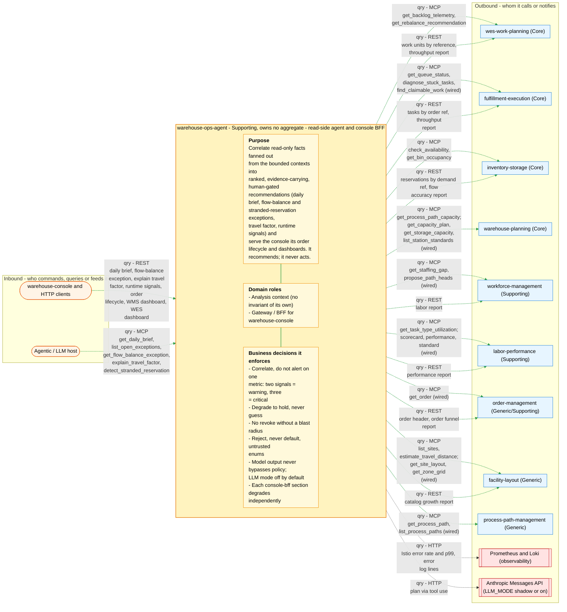

# Bounded context canvas

Following the ddd-crew
[Bounded Context Canvas v5](https://github.com/ddd-crew/bounded-context-canvas).
Every message row below maps to a real route in
`internal/adapters/inbound/http/router.go`, a real tool in
`internal/adapters/inbound/mcp/tools.go`, or a real `callTool` /
HTTP path in `internal/adapters/outbound/`.

## Canvas at a glance

One picture of the sections below, laid out like the ddd-crew canvas:
inbound collaborators on the left, this context in the middle (purpose,
domain roles and the business decisions it enforces), outbound
collaborators on the right. Arrows follow the message type: **solid blue**
commands (`cmd`), **dotted green** queries (`qry`), **thick orange** events
(`evt`); each arrow names its channel and the messages it carries. Box shapes
mark the collaborator kind: rounded = people, UI or any client; blue =
sibling bounded context; double border = external system or platform;
grey = this context's own projector, reports or dead-letter path; dashed =
published today with no consumer. Channel names on the arrows are
abbreviated (REST, MCP, Kafka, HTTP, port); the Inbound and Outbound
Communication tables carry the exact route, tool, topic and CloudEvents
type for every message.

Source: the Inbound Communication and Outbound Communication tables of this
page, which map to `internal/adapters/inbound/{http,mcp}` and `internal/adapters/outbound/{mcpclient,restclient,llm,logs}`. The diagram omits assumptions, verification metrics, open
questions and the ubiquitous language (sections below), the relationship
pattern per message (OHS, ACL, Conformist, Customer/Supplier - see the
tables) and anything the tables mark as deprecated or platform-only
(health probes).

## Name

`warehouse-ops-agent` — the fleet's read-side decision-support agent and
`warehouse-console` Backend-for-Frontend (console-bff). One Go binary,
`cmd/agent`, listening on `AGENT_ADDR` (default `:8095`) for REST at `/`
and its own MCP server at `/mcp`.

## Purpose

Correlate read-only facts fanned out from the fleet's bounded contexts
into ranked, evidence-carrying, human-gated recommendations, so that no
upstream context has to own cross-context correlation that would blur its
boundary. Concretely it produces:

- the **E3 daily brief** (per-site, per-path facts plus open exceptions
  when two or more independent signals correlate), with an optional
  warehouse-planning **capacity outlook** (ADR 0013);
- the **E1 flow-balance exception** (`assign_labor` / `release_next_work`
  / `hold`), optionally arbitrated by an LLM (ADR 0004) and enriched by a
  labor-utilization overlay (ADR 0008);
- the **E2 stranded-reservation exception** (`revoke_reservation` with a
  mandatory blast radius, or `hold`);
- the **travel-factor** advisory (ADR 0009);
- the **runtime-signals** report (Istio error rate / p99 from Prometheus,
  error-log counts from Loki);
- and, for `warehouse-console`, the **order lifecycle** read model and the
  **WMS / WES report dashboards** (ADR 0002 / 0003).

It recommends; it never acts. There is no write path (zero write tools,
CI-enforced).

## Strategic Classification

| Aspect | Classification |
|---|---|
| Domain | **Supporting** on the fleet map, with the caveat in [Subdomain classification](./subdomain-classification.md): it owns no aggregate, so it is not a bounded context in the aggregate-and-invariant sense. See the [core domain chart](./core-domain-chart.md). |
| Business Model | Cost reduction / operator productivity: internal tooling that shortens time-to-diagnosis. No revenue capability. |
| Evolution | Custom-built (correlation policy); product (console-bff BFF shape); commodity inputs (Prometheus, Loki, LLM API). |

## Domain Roles

- **Analysis context** — observes facts other contexts own and synthesizes
  a diagnosis plus a recommendation (E1, E2, E3, ADR 0008 / 0009, runtime
  signals). No invariant of its own.
- **Gateway / BFF** — the console-bff routes are pure read-model
  projections stitched from other contexts' REST APIs, with no policy on
  top.

## Inbound Communication

All inbound traffic is synchronous and unauthenticated (ADR 0006). There
is no Kafka consumer.

| Collaborator | Message | Type | Channel | Relationship |
|---|---|---|---|---|
| Platform probes | health check | Query | REST `GET /healthz` | Platform |
| `warehouse-console`, HTTP clients | daily brief | Query | REST `GET /daily-brief` | Customer of this OHS |
| HTTP clients | flow-balance exception | Query | REST `GET /flow-balance/{pathId}?buildingId=&shiftId=` | Customer of this OHS |
| HTTP clients | explain travel factor | Query | REST `GET /explain-travel-factor?pathId=&fromLocationCode=&toLocationCode=` | Customer of this OHS |
| `warehouse-console` | order lifecycle | Query | REST `GET /console/orders/{id}/lifecycle` | BFF for its one frontend |
| `warehouse-console` | WMS dashboard | Query | REST `GET /console/reports/wms?from=&to=` | BFF for its one frontend |
| `warehouse-console` | WES dashboard | Query | REST `GET /console/reports/wes?from=&to=` | BFF for its one frontend |
| HTTP clients | runtime signals | Query | REST `GET /runtime-signals` | Customer of this OHS |
| Agentic / LLM host | daily brief | Query | MCP `get_daily_brief` | Customer of this OHS |
| Agentic / LLM host | open exceptions by min severity | Query | MCP `list_open_exceptions` | Customer of this OHS |
| Agentic / LLM host | flow-balance exception | Query | MCP `get_flow_balance_exception` (registered when wired) | Customer of this OHS |
| Agentic / LLM host | travel factor | Query | MCP `explain_travel_factor` (registered when wired) | Customer of this OHS |
| Agentic / LLM host | stranded reservation | Query | MCP `detect_stranded_reservation` (registered when wired) | Customer of this OHS |

All five MCP tools carry `ReadOnlyHint: true`. The MCP server is mounted on
the same chi router as REST (ADR 0010) and runs stateless (ADR 0012).

## Outbound Communication

Every outbound call is a read. "Live" means a use case calls it today;
"wired" means the client method exists but no use case calls it.

| Collaborator | Message | Type | Channel | Relationship |
|---|---|---|---|---|
| `wes-work-planning` (Core) | backlog telemetry | Query | MCP `get_backlog_telemetry` — live (daily brief) | Customer / Conformist of OHS |
| `wes-work-planning` (Core) | rebalance recommendation | Query | MCP `get_rebalance_recommendation` — live (E1) | Customer / Conformist of OHS |
| `fulfillment-execution` (Core) | queue status | Query | MCP `get_queue_status` — live (daily brief) | Customer / Conformist of OHS |
| `fulfillment-execution` (Core) | stuck tasks | Query | MCP `diagnose_stuck_tasks` — live (daily brief, E1, E2) | Customer / Conformist of OHS |
| `fulfillment-execution` (Core) | claimable work | Query | MCP `find_claimable_work` — wired | Customer / Conformist of OHS |
| `workforce-management` (Supporting) | staffing gap | Query | MCP `get_staffing_gap` — live (daily brief, E1) | Customer / Conformist of OHS |
| `workforce-management` (Supporting) | proposed path heads | Query | MCP `propose_path_heads` — wired | Customer / Conformist of OHS |
| `inventory-storage` (Core) | availability | Query | MCP `check_availability` — live (E2) | Customer / Conformist of OHS |
| `inventory-storage` (Core) | bin occupancy | Query | MCP `get_bin_occupancy` — live (E2 blast radius) | Customer / Conformist of OHS |
| `facility-layout` (Generic) | sites | Query | MCP `list_sites` — live (daily brief) | Customer / Conformist of OHS |
| `facility-layout` (Generic) | travel distance | Query | MCP `estimate_travel_distance` — live (ADR 0009) | Customer / Conformist of OHS |
| `facility-layout` (Generic) | site layout, zone grid | Query | MCP `get_site_layout`, `get_zone_grid` — wired | Customer / Conformist of OHS |
| `labor-performance` (Supporting) | task-type utilization | Query | MCP `get_task_type_utilization` — live (ADR 0008) | Customer / Conformist of OHS |
| `labor-performance` (Supporting) | scorecard, performance, standard | Query | MCP `get_associate_scorecard`, `get_task_type_performance`, `get_labor_standard` — wired | Customer / Conformist of OHS |
| `warehouse-planning` (Core) | path capacity | Query | MCP `get_process_path_capacity` — live (capacity outlook, only when `WAREHOUSE_PLANNING_MCP_ENDPOINT` is set) | Customer / Conformist of OHS (read tools only) |
| `warehouse-planning` (Core) | capacity plan, storage capacity, station standards | Query | MCP `get_capacity_plan`, `get_storage_capacity`, `list_station_standards` — wired | Customer / Conformist of OHS (read tools only) |
| `order-management` (Generic/Supporting) | order | Query | MCP `get_order` — wired | Customer / Conformist of OHS |
| `process-path-management` (Generic) | process paths | Query | MCP `get_process_path`, `list_process_paths` — wired | Customer / Conformist of OHS |
| `order-management` (Generic/Supporting) | order header | Query | REST `GET /orders/{id}` — live (order lifecycle) | Conformist |
| `inventory-storage` (Core) | reservations by demand ref | Query | REST `GET /reservations?demandRef=` — live (order lifecycle) | Conformist |
| `wes-work-planning` (Core) | work units by reference | Query | REST `GET /work-units?reference=` — live (order lifecycle) | Conformist |
| `fulfillment-execution` (Core) | tasks by order ref | Query | REST `GET /tasks?orderRef=` — live (order lifecycle, one call per work unit) | Conformist |
| `order-management` reports reader | order funnel + freshness | Query | REST `GET /reports/funnel`, `/reports/funnel/freshness` — live (WMS dashboard) | Conformist |
| `inventory-storage` reports reader | flow accuracy + freshness | Query | REST `GET /reports/flow-accuracy`, `/freshness` — live (WMS) | Conformist |
| `facility-layout` reports reader | catalog growth + freshness | Query | REST `GET /reports/catalog-growth`, `/freshness` — live (WMS) | Conformist |
| `wes-work-planning` reports reader | planning throughput + freshness | Query | REST `GET /reports/throughput`, `/freshness` — live (WES) | Conformist |
| `fulfillment-execution` reports reader | fulfillment throughput + freshness | Query | REST `GET /reports/throughput`, `/freshness` — live (WES) | Conformist |
| `workforce-management` reports reader | labor + freshness | Query | REST `GET /reports/labor`, `/freshness` — live (WES) | Conformist |
| `labor-performance` reports reader | performance + freshness | Query | REST `GET /reports/performance`, `/freshness` — live (WES) | Conformist |
| Prometheus (observability, not a context) | Istio error rate, p99 | Query | HTTP `GET /api/v1/query` — live (runtime signals) | Read-only telemetry source |
| Loki (observability, not a context) | error log lines | Query | HTTP `GET /loki/api/v1/query_range` — live (runtime signals) | Read-only telemetry source |
| Anthropic Messages API (external) | plan via tool use | Query | HTTP `POST /v1/messages` — only when `LLM_MODE` is `shadow` or `on` | External service behind the policy gate |

`network-fulfillment` (Supporting) is deliberately absent: this agent has
no client for it. No outbound message is a Command or an Event.

## Ubiquitous Language

See [Ubiquitous language](../business-context/ubiquitous-language.md).
Top terms: **DailyBrief**, **PathBrief**, **OpenException**,
**FlowBalanceException** (`policy.Decision`), **StrandedReservationException**,
**Evidence trail**, **Blast radius**, **PathTarget**,
**UtilizationCorrelation**, **TravelFactorCorrelation**,
**CapacityOutlook**, **ServiceSignal**, **LLMMode** / **DecisionSource**.

## Business Decisions

- **Correlate, don't alert on one metric**: `deriveExceptions` flags a path
  only when at least two of backlog-over-alarm, understaffed and stuck
  tasks fire; three is `critical`, two is `warning`.
- **Degrade to hold, never guess**: a missing anchor signal yields a
  `Partial` `hold` (E1) or a typed `hold` with an evidence line (E2).
- **No revoke without a blast radius**: `Evaluate` cannot return
  `revoke_reservation` unless `get_bin_occupancy` answered and a
  `reservationId` was supplied.
- **Reject, never default, untrusted enums**: `ParseRebalanceAction`,
  `TaskType.Valid`, `severityRank`, `ParseLLMMode`, `ValidatePlan`.
- **Model output never bypasses policy**: `Arbitrate` is the only place a
  plan meets the deterministic decision; `off` is the default.
- **Capacity outlook is informational and fail-open**: it never feeds
  `deriveExceptions` and failures become `omittedReason`.
- **Each console-bff stage / section degrades independently**; an order
  not found in order-management is the only 404. Decided 2026-10-06 (kept,
  ADR 0002): an unreachable order-management leaves its stage `null` in a
  200 — the agent is an advisory read-side aggregator and one dependency
  outage must not fail the whole view.

## Assumptions

- Upstream MCP tool schemas and REST shapes stay stable; the agent mirrors
  them by hand (no shared Go types).
- `DAILY_BRIEF_PATH_TARGETS` correctly binds each context's own name for
  the same process path; the agent never infers it. Decided 2026-10-06
  (ADR 0017): unset selects the default target; unparseable JSON or an
  empty array `[]` fails startup with a config error naming the variable.
- The console is the only consumer of `/console/**`.
- Per-request re-reading is cheap enough that no cache or store is needed.

## Verification Metrics

- `TestNoDirectDependencyOnBoundedContexts`, `TestHexagonalDependencyRules`,
  `TestMCPAdapterDependencyRule`, `TestNoAuthMiddlewareReintroduced`
  (`internal/architecture`).
- `TestNoMutatingHTTPMethodInOutboundClients`,
  `TestNoMutatingToolAnnotationInMCPServer`, `TestMCPClientsCallOnlyReadTools`
  (`internal/architecture/zerowrite`).
- 90% coverage gate (`make coverage`), gremlins mutation job over
  `./internal/domain` (`make mutation-fast`).
- Runtime: `ops_agent_llm_agreement_total{agree}` (shadow agreement rate)
  and `circuit_breaker_state{dependency="anthropic-llm"}`.

## Open Questions

- `order-management` and `process-path-management` MCP clients, three
  warehouse-planning read tools, three labor-performance tools,
  `find_claimable_work`, `propose_path_heads`, `get_site_layout` and
  `get_zone_grid` are wired but unconsumed (ADR 0007, ADR 0013).
- E2 has an MCP tool but no REST route.
- DailyBrief (E3) LLM-reasoner coverage is a documented next phase of
  ADR 0004, not implemented.
- `explain_travel_factor` cannot resolve location codes itself (ADR 0009).
- What would an act slice's authorization gate be, now that ADR 0006
  removed fleet auth? (Governance note.)
